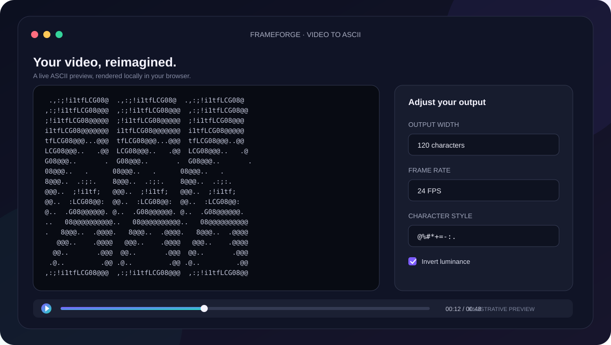

# Frameforge

**Turn video into ASCII art—right in your browser.**

Frameforge is a browser-based video-to-ASCII converter built with Next.js. Upload a local video, watch its frames transform into live ASCII art, tune the output, and export a frame as a text file. Video processing stays on your device; files are not uploaded to a server.

## Preview



*Illustrative preview, not a screenshot of the running application.*

## Features

- Load a local video from your device
- Convert video frames into ASCII art in real time
- Adjust output width and playback frame rate
- Choose from multiple character/glyph styles
- Invert luminance to change the light/dark mapping
- Play, pause, and scrub through the video
- Export the current ASCII frame as a `.txt` file
- Process video entirely in the browser—no server-side media processing

## Built With

- [Next.js](https://nextjs.org/)
- [React](https://react.dev/)
- [TypeScript](https://www.typescriptlang.org/)
- HTML5 Video and Canvas APIs

## Run Locally

### Requirements

- Node.js and npm

### Setup

```bash
git clone https://github.com/khalidsahalSYS/Video-to-ASCII-converter.git
cd Video-to-ASCII-converter
npm install
npm run dev
```

Open [http://localhost:3000](http://localhost:3000) in your browser.

## Production Build

```bash
npm run build
```

## Privacy

Video processing uses browser video and canvas APIs. Uploaded files are processed locally and are not sent to an external server.

## Repository

https://github.com/khalidsahalSYS/Video-to-ASCII-converter
